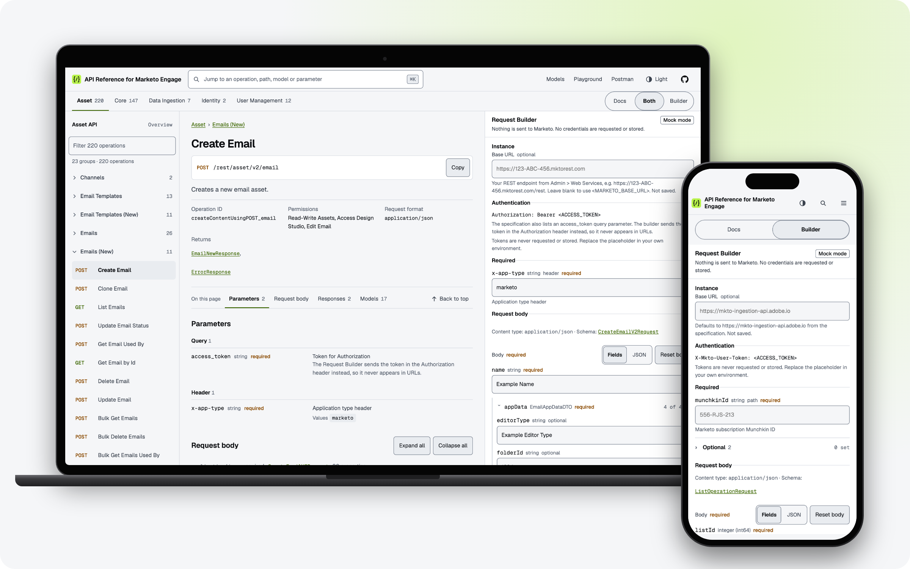
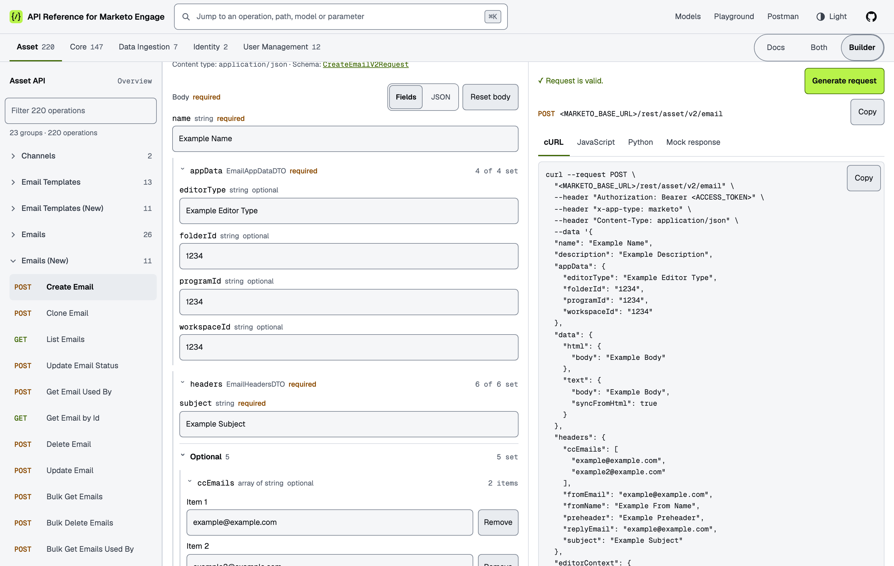
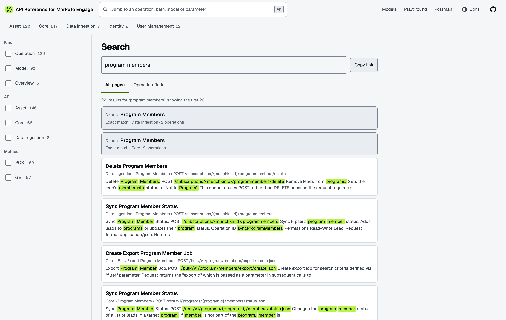
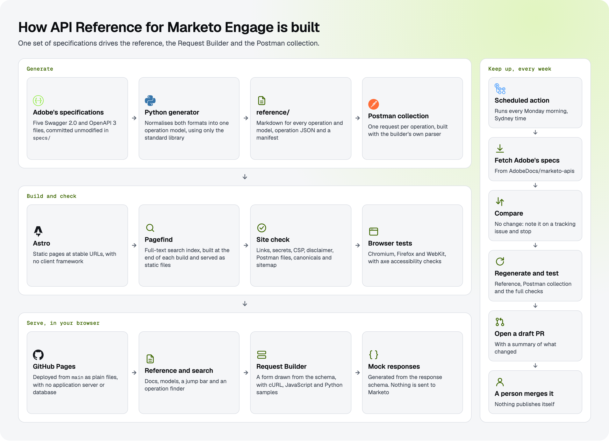

<div align="center">

<a href="https://mkto-ref.harrisonjennings.au/">
  
</a>

# API Reference for Marketo Engage

**An independent, searchable reference for the Adobe Marketo Engage APIs**<br>
Generated from Adobe's published specifications, with a request builder and mock responses that run entirely in your browser.

[](https://github.com/harrison-jennings/api-reference-for-marketo-engage/actions/workflows/pages.yml)
[](https://github.com/harrison-jennings/api-reference-for-marketo-engage/actions/workflows/adobe-spec-check.yml)
[](https://mkto-ref.harrisonjennings.au/)
[](reference/README.md)
[](reference/README.md)
[](https://github.com/harrison-jennings/api-reference-for-marketo-engage/commits/main/specs)
[](https://astro.build/)
[](https://pagefind.app/)
[](.nvmrc)
[](https://www.python.org/)
[](LICENSE)

<br>

<a href="https://mkto-ref.harrisonjennings.au/">
  <picture>
    <source media="(prefers-color-scheme: dark)" srcset="docs/images/screenshot-dark.png">
    
  </picture>
</a>

</div>

> [!NOTE]
> THIS PROJECT IS NOT AUTHORIZED, ENDORSED OR SPONSORED BY ADOBE, PUBLISHER OF ADOBE MARKETO
> ENGAGE. Adobe, Marketo and Marketo Engage are either registered trademarks or trademarks of Adobe
> in the United States and/or other countries. For authoritative documentation, see
> [Adobe's Marketo Engage developer documentation](https://developer.adobe.com/marketo-apis/).

---

## What this is

Adobe publishes machine-readable specifications for the Marketo Engage APIs. This project turns them
into four things, all from the same source:

- **A documentation site** at [mkto-ref.harrisonjennings.au](https://mkto-ref.harrisonjennings.au/):
  **388 operations** and **459 models**, with full-text search, a jump bar and an operation finder.
- **A Request Builder** on every operation page: fill in a form drawn from the schema, get cURL,
  JavaScript and Python samples, and generate a mock response.
- **A Postman collection** with one request for every operation, in [`postman/`](postman/).
- **Plain files** you can use directly: Markdown that reads well here on GitHub, a JSON file for every
  operation, and an index of them all in [`reference/manifest.json`](reference/manifest.json).

This is a reference and tooling project, not an SDK.

## API coverage

| API | Operations | Models | Description |
|---|---:|---:|---|
| [Asset API](reference/asset/README.md) | 220 | 255 | Emails, templates, forms, landing pages, programs, smart campaigns, smart lists, files, folders, snippets, tokens and other marketing assets |
| [Core API](reference/core/README.md) | 147 | 175 | Leads, activities, campaigns, companies, custom objects, opportunities, lists, bulk operations and usage statistics |
| [Data Ingestion API](reference/data-ingestion/README.md) | 7 | 15 | High-volume ingestion of persons, companies, custom objects, list memberships and program members |
| [Identity API](reference/identity/README.md) | 2 | 2 | Authentication and access tokens |
| [User Management API](reference/user-management/README.md) | 12 | 12 | Users, invitations, roles, workspaces and access assignments |
| **Total** | **388** | **459** | |

## The Request Builder

<picture>
  <source media="(prefers-color-scheme: dark)" srcset="docs/images/fields-dark.png">
  
</picture>

The builder isn't written per endpoint. It reads an operation's JSON and draws the form from it:

- **Parameters** become controls: dropdowns for allowed values, and checks against the schema as you type.
- **Request bodies** have two views of the same value. **Fields** shows every property, with nesting and
  add and remove for arrays. **JSON** is there whenever you'd rather type it.
- **Samples** update as you go, in cURL, JavaScript (`fetch`) and Python (`requests`).
- **Mock responses** come from the specification's example or the response schema, and reflect your
  request where they can. They model the contract, not Marketo's behaviour.

**It runs in mock mode only.** It never sends a request to Marketo, and it never asks for a Client ID,
Client Secret or access token. Samples use placeholders such as `<ACCESS_TOKEN>`, and the site's
Content Security Policy only lets it connect to its own files. A browser test fails if any request
leaves the site.

## Finding things

<picture>
  <source media="(prefers-color-scheme: dark)" srcset="docs/images/search-dark.png">
  
</picture>

- **Jump bar:** press `/` or ⌘K from anywhere, and type an operation name, path, operation ID or model.
- **Full-text search:** [Pagefind](https://pagefind.app/) runs in the browser, with filters for kind, API
  and method. There's no search server.
- **Operation finder:** a filterable list of all 388 operations, by name, path or method.
- **Models list:** all 459, filtered by name, API, kind or first letter.

## How it's built

<picture>
  <source media="(prefers-color-scheme: dark)" srcset="docs/images/architecture-dark.png">
  
</picture>

### Notable engineering decisions

- **One source of truth.** The page that says an endpoint takes an optional parameter and the control
  that lets you set it come from the same data, so they can't disagree.
- **Two specification formats, one model.** Adobe uses both Swagger 2.0 and OpenAPI 3. The generator
  normalises them, so nothing after it needs to care which is which.
- **Generated files are checked, not trusted.** CI regenerates `reference/` and `postman/` and fails if
  either differs from what's committed.
- **A person stays in the loop.** A weekly action opens a draft pull request when Adobe's specifications
  change. Nothing publishes itself.
- **Static, with no client framework.** Every page is a file. The only JavaScript is a few small scripts,
  and the builder only loads on the pages that use it.
- **Self-contained by policy.** A Content Security Policy on every page blocks connections to other hosts,
  fonts are self-hosted, and there's no analytics.
- **Tested the way it's served.** Browser tests run in Chromium, Firefox and WebKit against the built
  site, served as GitHub Pages serves it, with axe accessibility checks in both themes.
- **Built to be found.** Unique titles and descriptions, canonical links, structured data and a sitemap,
  all enforced by the site check.

More in [docs/architecture.md](docs/architecture.md) and [docs/decisions.md](docs/decisions.md).

## Quick start

You'll need [Node.js](https://nodejs.org/) 22.23 or later (`.nvmrc` says 24), Python 3.10 or later, Make and Git. On Windows, use
[WSL](https://learn.microsoft.com/windows/wsl/install).

```sh
git clone https://github.com/harrison-jennings/api-reference-for-marketo-engage.git
cd api-reference-for-marketo-engage
make setup      # check the prerequisites and install the site's dependencies
make web-dev    # http://127.0.0.1:4321/
make docs-ci    # tests, generated file checks, build and site validation
```

| Command | What it does |
|---|---|
| `make web-dev` | Runs the site with live reload |
| `make docs-build` | Builds the site into `web/dist/` and validates it |
| `make docs-test` | Runs the Request Builder unit tests |
| `make docs-e2e` | Runs the browser tests against the build (first run `npx playwright install` in `web/`) |
| `make docs-ci` | Runs the tests, the generated file checks, the build and the validation |
| `make reference` | Rebuilds `reference/` from `specs/`, without network access |
| `make specs-update` | Downloads Adobe's latest specifications, then rebuilds `reference/` |
| `make postman` | Rebuilds the Postman collection and environment template from `reference/` |

Run `make help` for every task. [docs/development.md](docs/development.md) covers regenerating the
reference and reviewing Adobe's changes.

## Using the reference

Start at the [reference index](reference/README.md), choose an API, then an endpoint group. Each
operation page documents the method and path, authentication, parameters, request and response
schemas with examples, and links to its models.

Each operation also has a `*.operation.json` file beside its page, holding the operation and the
schemas it references. [`reference/manifest.json`](reference/manifest.json) indexes every operation by
specification, API, endpoint group, method, path, title and operation ID, for use in search tools, API
explorers and code generators.

## Postman collection

An unofficial [Postman](https://www.postman.com/) collection with one request for every operation, and a
credential-free environment template. Import both files from [`postman/`](postman/) or the
[documentation site](https://mkto-ref.harrisonjennings.au/postman/), fill in the environment and send the
Identity request. [`postman/README.md`](postman/README.md) covers setup, credential storage and limitations.

The collection includes operations that change and delete data. Don't run it with the Collection Runner.

## How it's put together

```text
.github/workflows/   build and deploy, and the weekly specification check
docs/                architecture, decisions, design, development and the README images
postman/             generated Postman collection and environment template
reference/           generated reference: Markdown, operation JSON and manifest.json
scripts/             reference and Postman generators, change summaries and their tests
specs/               Adobe's specifications, unmodified
web/
  builder/           the Request Builder: plain JavaScript modules with no dependencies
  public/            fonts, images and other static files
  scripts/           build preparation, the site check and the README image scripts
  src/               Astro pages, layouts, components, styles and client scripts
  tests/builder/     unit tests, run against every operation
  tests/e2e/         browser tests
```

## Contributing

This project doesn't accept pull requests. See [CONTRIBUTING.md](CONTRIBUTING.md) for how to report
problems, and [SECURITY.md](SECURITY.md) to report a vulnerability privately.

## Sources and licence

The reference is generated from Adobe's Marketo Engage API specifications, published in
[AdobeDocs/marketo-apis](https://github.com/AdobeDocs/marketo-apis). The files in `specs/` are
unmodified copies, © Adobe and licensed under the Apache License 2.0, and `reference/` is generated
from them. See [NOTICE](NOTICE) for attribution.

Use of the Marketo APIs themselves is subject to Adobe's
[API License Agreement](https://experienceleague.adobe.com/en/docs/marketo-developer/marketo/api-license).

The site uses the [Geist](https://vercel.com/font) fonts, under the SIL Open Font License, and the README's
diagram uses logos from [Simple Icons](https://simpleicons.org/), under CC0.

This project is © 2026 [Harrison Jennings](https://www.harrisonjennings.au/) and licensed under the
[Apache License, Version 2.0](LICENSE).
